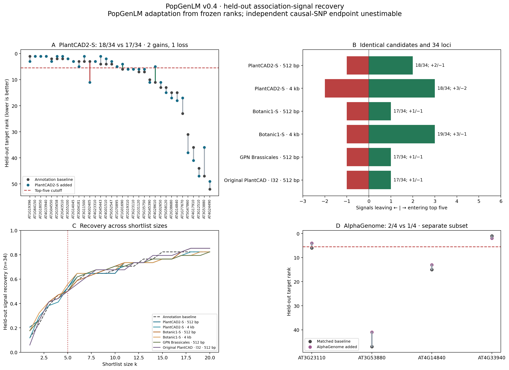

# PopGenLM Bench v0.4.0 · Regulatory Variant Prioritization Pilot

Can sequence-model evidence improve a shortlist of natural Arabidopsis regulatory variants beyond association, LD and annotation? The frozen pilot evaluates **held-out association-signal recovery**. PlantCAD2-S at 512 bp recovers **18/34** signals versus **17/34** for the candidate-matched annotation baseline: **two gains, one loss**. Botanic1-S at 4 kb recovers **19/34**, with three gains and one loss. These descriptive results justify inspecting model-assisted shortlists. They do not establish causal SNPs: the independent causal-nucleotide endpoint remains **unestimable, with zero eligible loci**.

This release extends v0.3.0 without replacing v0.1.0–v0.3.0. [GitHub release](https://github.com/tahirali-biomics/popgenlm-bench/releases/tag/v0.4.0) · [Overview Colab](https://colab.research.google.com/github/tahirali-biomics/popgenlm-bench/blob/v0.4.0/notebooks/v0.4/popgenlm-v04-overview.ipynb) · [Data terms](v0.4_data_terms.md) · [References and dataset citations](v0.4_references.md). The raw Botanic score columns are intentionally omitted from public data; its scholarly figures/ranks remain visible with attribution. AlphaGenome outputs retain their provider terms.

## From genomes to reliable AI evaluation

| Release | Biological / engineering progression | Runnable evidence |
| --- | --- | --- |
| v0.1 | Verified GPN fixture: establish allele/reference and score contracts before interpretation | [Fixture](../data/fixtures/gpn-scores-100.tsv), [validation](../scripts/validate_reference_alleles.py), [demo notebook](../notebooks/popgenlm-bench-demo.ipynb) |
| v0.2 | Population-aware benchmark: deterministic 10,000-SNP selection, allele counts, frequency and minor/major orientation | [Builder](../scripts/build_v02_population_gpn.py), [orientation code](../src/popgenlm/orientation.py), [reference check](../data/benchmarks/v0.2/1001g_population_10000.reference_validation.json), [notebook](../notebooks/popgenlm-bench-v0.2.ipynb) |
| v0.3 | Multi-model evolutionary evidence: GPN, original PlantCAD and site-level PhyloP, genomic context and LD-aware descriptive comparisons | [Release](v0.3_release.md), [14-asset manifest](../data/benchmarks/v0.3/manifest.json), [production contracts](v0.3_production_provenance.md), [notebook](../notebooks/popgenlm-bench-v0.3.ipynb) |
| v0.4 | Regulatory variant prioritization: frozen discovery/holdout separation, matched candidates, model-specific outputs, restartable shards and CPU reconstruction | [Preparation](../scripts/v0.4/prepare_benchmark.py), [integration](../scripts/v0.4/integrate_models.py), [verification](../scripts/v0.4/verify_model_extension.py), [shared review code](../review/v0.4/review.py), [overview Colab](../notebooks/v0.4/popgenlm-v04-overview.ipynb) |

The progression is expressed in the software contracts: REF checks precede scoring; population orientation stays distinct from raw allele effects; candidate identity is checked before comparing ranks; and evidence resolution constrains the claims. The notebooks reuse one evaluation implementation, with optional inference clearly separated from the CPU result.

## Inspect the benchmark first

[SVG](../figures/v0.4/benchmark.svg). **PopGenLM adaptation from cached inference**, not a source-data redraw or a new inference rerun. Panel A leads with PlantCAD2-S per-locus baseline/model target ranks and the top-five boundary. Panel B shows gains and losses on identical candidates and 34 eligible loci. Panel C reports recovery over shortlist sizes 1–20. Panel D shows each of the four AlphaGenome outcomes on its own denominator. Signed rules developed on the original loci are excluded from the headline and remain exploratory.

| Magnitude rule | Baseline → model top-five recovery | Gains / losses | Paired scope |
| --- | --- | --- | --- |
| PlantCAD2-S 512 bp | 17/34 → 18/34 | 2 / 1 | matched_MLM |
| PlantCAD2-S 4 kb | 17/34 → 18/34 | 3 / 2 | matched_MLM |
| Botanic1-S 512 bp | 17/34 → 17/34 | 1 / 1 | matched_MLM |
| Botanic1-S 4 kb | 17/34 → 19/34 | 3 / 1 | matched_MLM |
| GPN Brassicales 512 bp | 17/34 → 17/34 | 1 / 1 | matched_MLM |
| Original PlantCAD l32 512 bp | 17/34 → 17/34 | 1 / 1 | matched_MLM |
| nemo B. napus transfer | 8/14 → 8/14 | 0 / 0 | legacy_nemo_shared |
| AlphaGenome mammalian-to-plant transfer | 1/4 → 2/4 | 1 / 0 | alpha_MLM_shared |

| AlphaGenome eligible locus | Candidates | Baseline target rank | Model-added target rank | Outcome |
| --- | --- | --- | --- | --- |
| AT3G23110 | 7 | 6 | 4 | gain |
| AT3G53880 | 61 | 47 | 41 | retained miss |
| AT4G14840 | 35 | 15 | 13 | retained miss |
| AT4G33940 | 21 | 1 | 2 | retained hit |

AlphaGenome scored 194 SNPs in five predefined loci; AT2G22240 fails the frozen held-out significance threshold and is illustrative only. These four eligible loci have 124 candidates and span two chromosomes. They are never pooled into the 34-locus headline. Including nemo in an all-model intersection leaves only three eligible loci (all models 1/3), which is not a useful general leaderboard.

The annotation baseline is fixed: association+LD = `.9 * discovery association percentile + .1 * lead r²`; annotation score = `.8 * association+LD + .1 * exp(-abs(TSS distance)/2000) + .05 * percentile(PhyloP.fillna(0)) + .05 * non-CDS`. Model-added priority = `.8 * annotation score + .2 * within-locus percentile(model magnitude)`, with lexicographic variant-ID ties. The coefficients are not fitted. Full-locus held-out minimum-P targets and the `.05 / full candidate count` threshold never change with model coverage. Ranking needs at least six covered candidates. The earlier prose shorthand “missing PhyloP → 0” means filling the site score before percentile ranking, not assigning a zero percentile.

[Paired metrics](https://github.com/tahirali-biomics/popgenlm-bench/releases/download/v0.4.0/paired_metrics.tsv), [every candidate rank](https://github.com/tahirali-biomics/popgenlm-bench/releases/download/v0.4.0/rankings.tsv), [per-locus outcomes](https://github.com/tahirali-biomics/popgenlm-bench/releases/download/v0.4.0/per_locus_outcomes.tsv). The original 2,000-replicate whole-chromosome paired bootstrap uses seed 20261114, five blocks on the full panel and two for AlphaGenome. These intervals describe this small, ascertained sample; no confirmatory hypothesis test is claimed. Exploratory signed PlantCAD2-S is 22/34 versus 17/34 and signed Botanic1-S is 21/34 versus 17/34; neither is independent validation.

## Worked loci on TAIR10.1

[Gain AT1G01690](../figures/v0.4/locus_AT1G01690.svg) places the longest annotated transcript, discovery and held-out association, discovery-lead LD, signed site PhyloP, signed model LLRs, available nemo effects and candidate ranks on one 1-based TAIR10.1 axis. The held-out target `1:249256:T:C` enters at rank 4 from baseline 6; `1:247721:C:T` leaves at rank 6 from baseline 3. All other top-five members are retained. [Exact shortlist membership](../figures/v0.4/AT1G01690_shortlist_changes.tsv).

[Loss AT4G02405](../figures/v0.4/locus_AT4G02405.svg) is selected as the lexicographically first PlantCAD2-S loss in the cached ranks, after observing the outcomes; it is an illustration, not an independent case study. Target `4:1059349:C:A` moves from rank 3 to 11. `4:1051450:T:C` also leaves; `4:1051373:T:A` and `4:1061438:C:G` enter. [Exact changes](../figures/v0.4/AT4G02405_shortlist_changes.tsv). Both figures are PopGenLM adaptations. Gaps in model scores represent unavailable coverage, never measured zero effects. AlphaGenome was not run at these loci.

## Model identity and evidence

All scores use TAIR10.1 genomic REF/ALT identities. MLMs retain signed `log P(ALT) − log P(REF)` in natural-log units and forward/RC components; ranking uses the absolute signed aggregate. Population minor-minus-major orientation remains separate in the raw shards and v0.3 assets. Positive signed LLR favors ALT; it is not an expression effect. The shared CPU views carry the raw signed aggregate used for reconstruction; the original complete shards preserve all other orientations.

| Input | Exact checkpoint / revision | What it measures; units/orientation | Context used | Training species or source alignment | Candidate coverage | Evaluation endpoint |
| --- | --- | --- | --- | --- | --- | --- |
| PhyloP | PlantRegMap `Ath_PhyloP.bedGraph.gz`; exact input digest in [pilot verification](../data/benchmarks/v0.4/provenance/input_verification.json) | Signed site conservation/acceleration statistic, not allele-specific; positive conservation | Single reference site | PlantRegMap comparative plant alignment; exact taxa/tree not recovered in cached metadata, not asserted | 1,195/1,205; ten missing | Conservation reference in annotation baseline; descriptive v0.3 concordance |
| GPN Brassicales | `songlab/gpn-brassicales` / `eb9c35d0d18571abe84390d22e74f2b21d319ce3` | Masked allele likelihood LLR, nats | 512 bp | A. thaliana + seven other Brassicales; [pinned card](https://huggingface.co/songlab/gpn-brassicales/blob/eb9c35d0d18571abe84390d22e74f2b21d319ce3/README.md) | 1,205/1,205; 40/40 complete loci | Matched held-out signal recovery; retained v0.3 population evidence |
| Original PlantCAD (legacy “PlantCAD-S”) | **`kuleshov-group/PlantCaduceus_l32`** / `e624c13c3d35415348b854c87a218893b23564f7` | Masked allele likelihood LLR, nats; this is l32, not a verified Small checkpoint | 512 bp | 16 angiosperm genomes; [model card](https://huggingface.co/kuleshov-group/PlantCaduceus_l32) | 1,205/1,205; 40/40 complete loci | Same matched endpoint; retained v0.3 population evidence |
| PlantCAD2-S | `kuleshov-group/PlantCAD2-Small-l24-d0768` / `f756c255cb76e9f538c3acec04acf4214ed03fb3` | Masked allele likelihood LLR, nats | 512 / 4,096 bp (evaluation windows, not a maximum-context claim) | 65 plant genomes per [official PlantCAD2 documentation](https://github.com/plantcad/plantcad/blob/main/docs/PlantCAD2-overview.md); pinned HF card has no substantive training description | 1,205/1,205 at each context | Same matched endpoint and context sensitivity |
| Botanic1-S | `living-models/Botanic1-S` / `813d2d46ca40ab5cd91a6acaa8852d636224992e` | Masked allele likelihood LLR, nats; +CLS focal offset, forward/RC mean | 512 / 4,096 genomic bp; 513/4,097 tokens | Land-plant pretraining, 320-genome corpus described in [bioRxiv v3](https://www.biorxiv.org/content/10.64898/2026.09.04.749355v3.full); exact stage membership requires source manifest | 1,205/1,205 at each context | Same matched endpoint; **not** ATAC accessibility evaluation |
| nemo | B. napus released `nemo_v1.0_weights.h5`; source `c8deaaf18a8bd174300bf40e11fa2c69c0d6bb4e`; weights SHA-256 `85bec6231833d41a432e7be99e6cf3a109ac275453017062a64d990fbaad374c` | Predicted ALT−REF `log10(TPM+0.1)` after saved inverse scaling; positive predicts increase | Two 6,200-bp transcript-oriented promoter/terminator windows; CDS masked | B. napus Express617; **cross-species transfer to A. thaliana**, homolog overlap unresolved | 507/1,205; 435 CDS-masked, 263 outside windows | Matched 8/14 vs 8/14; not native or family-held-out validation |
| AlphaGenome | AlphaGenome 1 API `alphagenome.models.v1`, `ALL_FOLDS`, SDK `0.11.0`; server weight digest unavailable | Mean absolute `log1p(ALT) − log1p(REF)` prediction difference, all 667 human RNA_SEQ tracks; not plant expression units | 131,072 bp inputs; cached central 2,048 bp at 1-bp resolution | Mammalian human/mouse model; organism flag HOMO_SAPIENS; **mammalian-to-plant transfer** | 194/1,205; five predefined loci, four eligible | Candidate-matched 2/4 vs 1/4; no plant direction calibration |

GPN and original PlantCAD coverage is complete, verified by hash-checked chromosome shards and exact candidate IDs. No additional scoring is needed. Their focused notebooks preserve the v0.3 minor-versus-major evolutionary evidence alongside v0.4 ranks. Checkpoint/weight, environment, strand and SLURM evidence lives in [the portable provenance directory](../data/benchmarks/v0.4/provenance/) and [the original production manifests](../data/benchmarks/v0.4/provenance/). Raw published/source-model outputs are not replaced by harmonized ranks.

Native A. thaliana nemo still needs the native checkpoint; family-safe gene assignments and train/validation/test folds; the historical E-CURD sample reconciliation (54/56 reported conditions versus the recovered 57); processed Express617 joint-family inputs and exact label scalers. The recovered E-CURD matrix includes all 40 genes but is insufficient to recreate the native evaluation. No arbitrary split or B. napus weights are relabelled native.

## Workflow and evidence trail

Population candidates come from the **1001 Genomes Consortium (2016)** v3.1 callset; reference checks use **NCBI TAIR10.1 GCF_000001735.4**. The accession join uses **GSE80744 / Kawakatsu et al. (2016)** processed expression. The cis-regulatory/eQTL context and reporter audit follow **Voichek et al. (2024)** and its exact code deposit **Zenodo13170729**; PopGenLM recomputes LOCO null-REML mapping and does not claim an exact rerun of that study's batch pipeline. [Full citations and source links](v0.4_references.md).

| Step | Implementation | Manifest / check / output |
| --- | --- | --- |
| TAIR10.1 REF validation and source integrity | [verify_inputs.py](../scripts/v0.4/verify_inputs.py), [context and REF contracts](../src/popgenlm/regulatory.py) | [input verification](../data/benchmarks/v0.4/provenance/input_verification.json); assembly GCF_000001735.4 |
| 1001 Genomes v3.1–GSE80744 expression join | [prepare_benchmark.py](../scripts/v0.4/prepare_benchmark.py) | [crosswalk](../data/benchmarks/v0.4/provenance/accession_crosswalk.tsv), [469/196 discovery/holdout samples](../data/benchmarks/v0.4/provenance/mapping_samples.tsv) |
| Deterministic freeze, LOCO null-REML mapping and same-accession LD | [preparation](../scripts/v0.4/prepare_benchmark.py), [mapping contracts](../src/popgenlm/regulatory.py) | [freeze](../data/benchmarks/v0.4/provenance/freeze.json), [40 loci](https://github.com/tahirali-biomics/popgenlm-bench/releases/download/v0.4.0/loci.tsv), [1,205 candidates](https://github.com/tahirali-biomics/popgenlm-bench/releases/download/v0.4.0/candidates.tsv) |
| Model scoring; restartable chromosome/context shards and API cache | [MLM](../scripts/v0.4/score_mlm.py), [Botanic](../scripts/v0.4/score_botanic.py), [nemo](../scripts/v0.4/score_nemo.py), [AlphaGenome](../scripts/v0.4/score_alphagenome.py) | [model protocol](../data/benchmarks/v0.4/provenance/model_protocol.json), [assets](../data/benchmarks/v0.4/provenance/botanic_assets.json), [job accounting](../data/benchmarks/v0.4/provenance/job_accounting.tsv) |
| Matched ranks and endpoint checks | [integrate_models.py](../scripts/v0.4/integrate_models.py), [independent verifier](../scripts/v0.4/verify_model_extension.py) | [cached verified report](v0.4_verified_run.md), [ranks](https://github.com/tahirali-biomics/popgenlm-bench/releases/download/v0.4.0/rankings.tsv) |
| CPU reproduction | [shared evaluator](../review/v0.4/review.py), [eight notebooks](../notebooks/v0.4/), [input assembler](../review/v0.4/build_review.py) | [original executed notebook](https://github.com/tahirali-biomics/popgenlm-bench/releases/download/v0.4.0/executed-notebooks.zip), [new verification](../data/benchmarks/v0.4/provenance/verification.json) |

## Model-specific figures and reproduction status

| Figure / notebook | Generation and source | Status / limits |
| --- | --- | --- |
| [PhyloP](../notebooks/v0.4/popgenlm-v04-phylop.ipynb) | PopGenLM adaptation: site distribution, model relation, v0.3 reference | Cached site scores, ten missing sites explicit |
| [GPN](../notebooks/v0.4/popgenlm-v04-gpn.ipynb) | PopGenLM adaptation: signed LLR, v0.3 concordance, target ranks | Complete coverage; no new inference |
| [Original PlantCAD](../notebooks/v0.4/popgenlm-v04-plantcad.ipynb) | PopGenLM adaptation: same output-appropriate evidence with exact l32 identity | Legacy alias documented |
| [PlantCAD2-S](../notebooks/v0.4/popgenlm-v04-plantcad2.ipynb) | PopGenLM adaptation: LLR, context and rank sensitivity | 512-bp and 4-kb cached predictions |
| [Botanic1-S](../notebooks/v0.4/popgenlm-v04-botanic.ipynb) | PopGenLM adaptation: completed 512-bp/4-kb zero-shot comparison | Separate Barozet et al. (2026), bioRxiv **v3 Fig. 4b/4d ATAC reproduction blocked**: verified Arabidopsis accessibility measurements, chr4 peak/label/test split, fine-tuned head or official predictions, and matched ChromBPNet predictions are not present. Do not substitute zero-shot LLRs for accessibility. v3 full-caption retrieval returned 403, so panel correspondence is user-specified and not independently verified. No source-data redraw claimed. |
| [nemo](../notebooks/v0.4/popgenlm-v04-nemo.ipynb) | PopGenLM adaptation motivated by Rockenbach et al. (2026), [Fig. 3a](https://doi.org/10.1093/plphys/kiag473): predicted expression delta by promoter/TTS position and matched transfer outcome | Native allele-aligned Fig. 3a reproduction blocked by resources above; no native accuracy claim |
| [AlphaGenome](../notebooks/v0.4/popgenlm-v04-alphagenome.ipynb) | PopGenLM adaptation of Avsec et al. (2026), [Fig. 4b and 6b](https://doi.org/10.1038/s41586-025-10014-0): REF, ALT, difference, focal SNP and gene model | Cached predictions; display track 0 by metadata order, `CL:0000047 polyA plus RNA-seq`, plus strand, neuronal stem cell; exact 667-track catalog/hash retained. Separate observed Arabidopsis processed gene expression by genotype is not base-resolution coverage. |

Source-paper figures are methodological references, not Arabidopsis validation results. The AlphaGenome figure uses the lexicographically first predefined locus (AT2G22240) and lexicographically first variant, independent of predicted effect magnitude. The original all-667-track ranking rule is retained. Metadata SHA-256: `f917e21766d6940695d61bf1294557c232b4358df95b069e6d4cfa0d65186111`. The central cache cannot show predictions elsewhere in the gene; no missing track extent is fabricated. Avsec Fig. 4b uses measured GTEx coverage, whereas this adaptation uses separate GSE80744 Arabidopsis processed expression groups; Fig. 6b inspires the difference display, not a claim to have rerun its multimodal TAL1 example.

## Public CPU reproduction

Open the overview or any of the seven focused notebooks. Each downloads `popgenlm-v04-public-inputs.zip` from this release, verifies SHA-256 `776c145febcc29d2c781a38c5a65b63fea2d5c647f0dd64d90e28d46f8676a9f`, then verifies every internal file before analysis. There are no credentials, model weights or RAMSES execution paths in this CPU path. The same shared evaluator regenerates permitted figures/counts and checks all published candidate-rank/outcome records.

**Reproduction boundary:** all non-Botanic candidate ranks are reconstructed from cached scores. Botanic outcomes are checked from published rank records, and the frozen scholarly LLR/context figure is displayed, not reconstructed from withheld raw scores. AlphaGenome uses194 aggregate cached scores plus the illustrative paired track; the full194×667-track cache aggregation is not rerun from this reduced public package. It was independently verified in the original run. These differences are printed in every notebook. [Exact data terms and separate-input route](v0.4_data_terms.md) · [Restricted-input digest](../data/benchmarks/v0.4/restricted_inputs.json).

Eight public notebooks passed in a new isolated CPU environment, with a fresh kernel and fresh archive extraction for each. The complete fast suite passed96 tests with7 optional-stack skips. [CPU verification](../data/benchmarks/v0.4/cpu_verification.json) records exact dependencies and notebook hashes. Local execution and anonymous Colab preview are separate: no notebook has been run in a signed-in hosted Colab runtime by this release process. The public Colab buttons load notebooks pinned to `v0.4.0`.

For local reproduction, create a separate virtual environment, install `requirements-v04-public-cpu.txt`, and run a notebook. Optional inference is clearly separated; checkpoint licenses, original genome/track hashes and acquisition locations are in the [source record](../data/benchmarks/v0.4/acquisition.json). No weights or full source genomes are distributed. Botanic source reproduction/native nemo limitations remain in the model table above.

The public input archive, numerical tables, executed-notebook ZIP and their SHA256SUMS are GitHub release assets. Larger artifacts remain outside Git. The frozen pilot and previous tags/bundles are preserved. See the [Genomes to AI release note](v0.4_genomes_to_ai.md) and [the journal](https://tahirali-biomics.github.io/genomes-to-ai.html) for the learning story.

## Attribution and figure rights

This work uses the Botanic™ model developed by Living Models, available under the Botanic™ Model License. Model-derived figures/results are noncommercial scholarly outputs, supplied as-is without warranties; modifications and provider notices are in [DATA TERMS](v0.4_data_terms.md). AlphaGenome outputs and derivatives are subject to its Output Terms of Use; they are not Apache data. All figures are **PopGenLM adaptations from cached inference**, not paper-artwork copies, source-data redraws or new inference reruns. Exact panel citations are in the model table and [reference record](v0.4_references.md).
