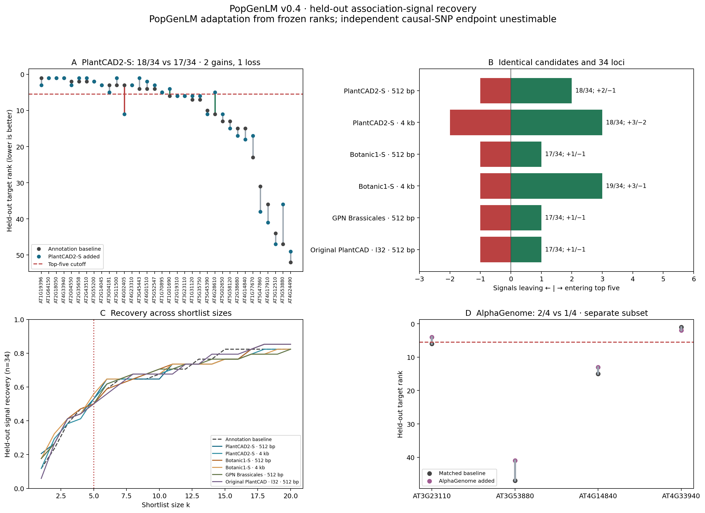

> Historical verified run report (2026-11-14). Its private-bundle status describes that run. For the public v0.4.0 package, see [data terms](v0.4_data_terms.md) and [release documentation](v0.4_release.md).

# PopGenLM v0.4: Botanic1-S and AlphaGenome extension

Local RAMSES review. Endpoint throughout is **held-out association-signal recovery**, not causal-SNP recovery. The independent nucleotide endpoint remains **unestimable (zero eligible loci)**. Original frozen candidates, holdout labels and conventional baseline are unchanged.

## Results

### model_covered

| method | model_hits | baseline_hits | loci | blocks | into_top5 | out_of_top5 | stayed_in | stayed_out | delta_pp | CI95_pp |
| --- | --- | --- | --- | --- | --- | --- | --- | --- | --- | --- |
| alphagenome_abs | 2 | 1 | 4 | 2 | 1 | 0 | 1 | 2 | +25.0 | 0.0, 50.0 |
| annotations | 17 | 17 | 34 | 5 | 0 | 0 | 17 | 17 | +0.0 | 0.0, 0.0 |
| association_ld | 17 | 17 | 34 | 5 | 1 | 1 | 16 | 16 | +0.0 | -7.9, 9.4 |
| botanic1_s_4096_abs | 19 | 17 | 34 | 5 | 3 | 1 | 16 | 14 | +5.9 | 0.0, 12.5 |
| botanic1_s_512_abs | 17 | 17 | 34 | 5 | 1 | 1 | 16 | 16 | +0.0 | -7.9, 9.4 |
| botanic1_s_512_signed_exploratory | 21 | 17 | 34 | 5 | 4 | 0 | 17 | 13 | +11.8 | 6.2, 15.2 |
| gpn_brassicales_512_abs | 17 | 17 | 34 | 5 | 1 | 1 | 16 | 16 | +0.0 | -7.9, 9.4 |
| nemo_bnapus_transfer_abs | 8 | 8 | 14 | 5 | 0 | 0 | 8 | 6 | +0.0 | 0.0, 0.0 |
| plantcad2_s_4096_abs | 18 | 17 | 34 | 5 | 3 | 2 | 15 | 14 | +2.9 | -6.1, 12.5 |
| plantcad2_s_512_abs | 18 | 17 | 34 | 5 | 2 | 1 | 16 | 15 | +2.9 | 0.0, 9.4 |
| plantcad2_s_512_signed_exploratory | 22 | 17 | 34 | 5 | 5 | 0 | 17 | 12 | +14.7 | 13.5, 16.1 |
| plantcad_v1_512_abs | 17 | 17 | 34 | 5 | 1 | 1 | 16 | 16 | +0.0 | -7.9, 9.4 |
### alpha_MLM_shared

| method | model_hits | baseline_hits | loci | blocks | into_top5 | out_of_top5 | stayed_in | stayed_out | delta_pp | CI95_pp |
| --- | --- | --- | --- | --- | --- | --- | --- | --- | --- | --- |
| alphagenome_abs | 2 | 1 | 4 | 2 | 1 | 0 | 1 | 2 | +25.0 | 0.0, 50.0 |
| annotations | 1 | 1 | 4 | 2 | 0 | 0 | 1 | 3 | +0.0 | 0.0, 0.0 |
| association_ld | 1 | 1 | 4 | 2 | 0 | 0 | 1 | 3 | +0.0 | 0.0, 0.0 |
| botanic1_s_4096_abs | 1 | 1 | 4 | 2 | 0 | 0 | 1 | 3 | +0.0 | 0.0, 0.0 |
| botanic1_s_512_abs | 1 | 1 | 4 | 2 | 0 | 0 | 1 | 3 | +0.0 | 0.0, 0.0 |
| botanic1_s_512_signed_exploratory | 2 | 1 | 4 | 2 | 1 | 0 | 1 | 2 | +25.0 | 0.0, 50.0 |
| gpn_brassicales_512_abs | 1 | 1 | 4 | 2 | 0 | 0 | 1 | 3 | +0.0 | 0.0, 0.0 |
| plantcad2_s_4096_abs | 1 | 1 | 4 | 2 | 0 | 0 | 1 | 3 | +0.0 | 0.0, 0.0 |
| plantcad2_s_512_abs | 1 | 1 | 4 | 2 | 0 | 0 | 1 | 3 | +0.0 | 0.0, 0.0 |
| plantcad2_s_512_signed_exploratory | 2 | 1 | 4 | 2 | 1 | 0 | 1 | 2 | +25.0 | 0.0, 50.0 |
| plantcad_v1_512_abs | 1 | 1 | 4 | 2 | 0 | 0 | 1 | 3 | +0.0 | 0.0, 0.0 |
### legacy_nemo_shared

| method | model_hits | baseline_hits | loci | blocks | into_top5 | out_of_top5 | stayed_in | stayed_out | delta_pp | CI95_pp |
| --- | --- | --- | --- | --- | --- | --- | --- | --- | --- | --- |
| annotations | 8 | 8 | 14 | 5 | 0 | 0 | 8 | 6 | +0.0 | 0.0, 0.0 |
| association_ld | 8 | 8 | 14 | 5 | 0 | 0 | 8 | 6 | +0.0 | 0.0, 0.0 |
| botanic1_s_4096_abs | 8 | 8 | 14 | 5 | 0 | 0 | 8 | 6 | +0.0 | 0.0, 0.0 |
| botanic1_s_512_abs | 8 | 8 | 14 | 5 | 0 | 0 | 8 | 6 | +0.0 | 0.0, 0.0 |
| botanic1_s_512_signed_exploratory | 8 | 8 | 14 | 5 | 0 | 0 | 8 | 6 | +0.0 | 0.0, 0.0 |
| gpn_brassicales_512_abs | 8 | 8 | 14 | 5 | 0 | 0 | 8 | 6 | +0.0 | 0.0, 0.0 |
| nemo_bnapus_transfer_abs | 8 | 8 | 14 | 5 | 0 | 0 | 8 | 6 | +0.0 | 0.0, 0.0 |
| plantcad2_s_4096_abs | 8 | 8 | 14 | 5 | 0 | 0 | 8 | 6 | +0.0 | 0.0, 0.0 |
| plantcad2_s_512_abs | 8 | 8 | 14 | 5 | 0 | 0 | 8 | 6 | +0.0 | 0.0, 0.0 |
| plantcad2_s_512_signed_exploratory | 8 | 8 | 14 | 5 | 0 | 0 | 8 | 6 | +0.0 | 0.0, 0.0 |
| plantcad_v1_512_abs | 8 | 8 | 14 | 5 | 0 | 0 | 8 | 6 | +0.0 | 0.0, 0.0 |
### all_models_shared

| method | model_hits | baseline_hits | loci | blocks | into_top5 | out_of_top5 | stayed_in | stayed_out | delta_pp | CI95_pp |
| --- | --- | --- | --- | --- | --- | --- | --- | --- | --- | --- |
| alphagenome_abs | 1 | 1 | 3 | 2 | 0 | 0 | 1 | 2 | +0.0 | 0.0, 0.0 |
| annotations | 1 | 1 | 3 | 2 | 0 | 0 | 1 | 2 | +0.0 | 0.0, 0.0 |
| association_ld | 1 | 1 | 3 | 2 | 0 | 0 | 1 | 2 | +0.0 | 0.0, 0.0 |
| botanic1_s_4096_abs | 1 | 1 | 3 | 2 | 0 | 0 | 1 | 2 | +0.0 | 0.0, 0.0 |
| botanic1_s_512_abs | 1 | 1 | 3 | 2 | 0 | 0 | 1 | 2 | +0.0 | 0.0, 0.0 |
| botanic1_s_512_signed_exploratory | 1 | 1 | 3 | 2 | 0 | 0 | 1 | 2 | +0.0 | 0.0, 0.0 |
| gpn_brassicales_512_abs | 1 | 1 | 3 | 2 | 0 | 0 | 1 | 2 | +0.0 | 0.0, 0.0 |
| nemo_bnapus_transfer_abs | 1 | 1 | 3 | 2 | 0 | 0 | 1 | 2 | +0.0 | 0.0, 0.0 |
| plantcad2_s_4096_abs | 1 | 1 | 3 | 2 | 0 | 0 | 1 | 2 | +0.0 | 0.0, 0.0 |
| plantcad2_s_512_abs | 1 | 1 | 3 | 2 | 0 | 0 | 1 | 2 | +0.0 | 0.0, 0.0 |
| plantcad2_s_512_signed_exploratory | 1 | 1 | 3 | 2 | 0 | 0 | 1 | 2 | +0.0 | 0.0, 0.0 |
| plantcad_v1_512_abs | 1 | 1 | 3 | 2 | 0 | 0 | 1 | 2 | +0.0 | 0.0, 0.0 |

`model_covered` compares every method with a baseline reranked on its identical covered candidates. `alpha_MLM_shared` uses the predefined AlphaGenome candidates and reranks each method/baseline on the same SNPs; nemo is excluded from this scope so all displayed methods use exactly the same candidates. `legacy_nemo_shared` preserves the original 507-SNP shared universe and 14 eligible loci. `all_models_shared` restricts every method to the intersection including nemo and AlphaGenome. Exact candidate IDs/counts, target ranks, gains, losses, retained hits/misses and LD strata are in `rankings.tsv`, `per_locus_outcomes.tsv` and `paired_metrics.tsv`. Uncertainty is a 2,000-replicate paired whole-chromosome bootstrap (seed 20261114), with only the stated number of chromosome blocks; small-subset intervals are descriptive and coarse. No weights were fitted, and no hypothesis test is claimed.

The carried-forward PlantCAD2-S signed 512bp result is asserted exactly at **22/34 versus 17/34**, five gains/zero losses. Its old shared-coverage result remains **8/14 versus 8/14**, as do saved B. napus nemo transfer scores. Native A. thaliana nemo remains unavailable because family-safe weights/folds and reconciled training inputs are missing. Signed-rule results on the original 40 loci remain exploratory; no independent validation is claimed.



## Direct matched model comparison

| challenger | comparator | model_hits | baseline_hits | loci | into_top5 | out_of_top5 |
| --- | --- | --- | --- | --- | --- | --- |
| botanic1_s_512_abs | plantcad2_s_512_abs | 17 | 18 | 34 | 0 | 1 |
| botanic1_s_4096_abs | plantcad2_s_4096_abs | 19 | 18 | 34 | 1 | 0 |
| botanic1_s_512_signed_exploratory | plantcad2_s_512_signed_exploratory | 21 | 22 | 34 | 0 | 1 |
| alphagenome_abs | plantcad2_s_512_abs | 2 | 1 | 4 | 1 | 0 |
| alphagenome_abs | plantcad2_s_4096_abs | 2 | 1 | 4 | 1 | 0 |

In this table baseline_hits is the named PlantCAD2 comparator's recovery, not the annotation baseline. Exact paired intervals and per-locus outcomes are in direct_comparisons.tsv and direct_per_locus.tsv; every row uses the same SNPs and loci for both models.

| gene | context_bp | SNPs | absolute_LLR_spearman |
| --- | --- | --- | --- |
| all_SNPs | 512 | 1205 | 0.78 |
| all_SNPs | 4096 | 1205 | 0.755 |

Absolute-LLR correlations are descriptive across the same SNPs at each context; per-locus correlations are also saved. They do not establish regulatory function.

## Coverage

| model | SNPs | total_SNPs | loci_with_any | complete_loci | total_loci | primary_nucleotide_loci |
| --- | --- | --- | --- | --- | --- | --- |
| plantcad2_s_512 | 1205 | 1205 | 40 | 40 | 40 | 0 |
| plantcad2_s_4096 | 1205 | 1205 | 40 | 40 | 40 | 0 |
| plantcad_v1_512 | 1205 | 1205 | 40 | 40 | 40 | 0 |
| gpn_brassicales_512 | 1205 | 1205 | 40 | 40 | 40 | 0 |
| nemo_bnapus_transfer | 507 | 1205 | 39 | 0 | 40 | 0 |
| botanic1_s_512 | 1205 | 1205 | 40 | 40 | 40 | 0 |
| botanic1_s_4096 | 1205 | 1205 | 40 | 40 | 40 | 0 |
| alphagenome | 194 | 1205 | 5 | 5 | 40 | 0 |

All 40 loci and 1,205 original SNPs are preserved. AlphaGenome's subset was selected before pilot scores: AT4G33940, AT3G23110, AT2G22240, AT4G14840, AT3G53880; it contains 194 SNPs. Coverage differences never redefine the full-panel held-out target or its p<.05/full candidate count eligibility threshold. At least six covered candidates are required for a top-five ranking comparison.

## Methods frozen before new scores

Conventional baseline: association+LD = .9 discovery association percentile + .1 lead r²; annotations = .8 association+LD + .1 exp(−|TSS distance|/2000) + .05 PhyloP percentile (missing→0) + .05 non-CDS. Each model adds .2 within-locus score percentile to .8 annotation baseline, with variant-ID tie breaking. Magnitude rules use |LLR| for genomic MLMs and |predicted expression delta| for nemo. Signed Botanic 512bp LLR uses the exact fixed .2 exploratory rule carried forward from PlantCAD2-S, prespecified in `inputs/model_protocol.json` before Botanic score inspection.

Botanic1-S: `living-models/Botanic1-S`, revision `813d2d46ca40ab5cd91a6acaa8852d636224992e`. All assets/weights are hash-recorded. Scores are masked logP(ALT)−logP(REF), averaged across forward/RC inputs; raw strand scores, signed REF→ALT score, population minor-minus-major orientation and |LLR| are saved. Same genomic bases/SNPs and 512/4096bp contexts as PlantCAD2-S; Botanic additionally requires its checkpoint's CLS token (513/4097 model tokens), with focal offset +1. No padding/truncation is used. Independent three-SNP TAIR10 fixtures test REF identity, exactly one mask, token offsets, finite scores, logit/log-probability identity, batch/single parity, official helper agreement and RC-order invariance. Pure-PyTorch inference avoids optional native-kernel dependencies. Botanic's two strands need not have equal raw logits; averaging gives a strand-invariant aggregate.

AlphaGenome: explicit **AlphaGenome 1 API v1 / ALL_FOLDS**, pinned SDK `0.11.0`, organism HOMO_SAPIENS, output RNA_SEQ, all **667 tracks** with exact metadata SHA-256 `f917e21766d6940695d61bf1294557c232b4358df95b069e6d4cfa0d65186111` frozen before predictions. This retains the original all-track protocol instead of choosing tracks from observed effects. Each SNP uses paired 131,072bp public TAIR10 sequences with identical flanks and only the focal nucleotide changed. Score = mean absolute difference of log1p predicted RNA-seq values over the central 2,048bp and all tracks. Outputs have 1bp resolution. Requests cache exact central prediction arrays, sequence/specification hashes and response metadata per allele; complete requests are reused after interruptions. No whole-genome or personal data were transmitted. The service does not expose a cryptographic checkpoint-weight digest; the reproducible analysis uses frozen cached predictions and scores, alongside the explicit API version/enum and metadata snapshot. This is exploratory cross-species transfer from mammalian-trained outputs; magnitude has no plant expression-direction interpretation.

## Worked loci

The original AT1G01690 and lexicographically first predefined AlphaGenome gene were selected independently of new model gains. The AlphaGenome worked gene AT2G22240 does not meet the frozen held-out significance threshold, so its shortlist is illustrative and contributes no recovery outcome. The other four predefined genes supply the AlphaGenome endpoint denominator, across only two chromosome blocks.

| gene | method | target_rank | top5 |
| --- | --- | --- | --- |
| AT1G01690 | annotations | 6 | 1:247789:G:A, 1:247850:A:G, 1:247721:C:T, 1:248737:A:C, 1:251006:C:T |
| AT1G01690 | plantcad2_s_512_abs | 4 | 1:247789:G:A, 1:251006:C:T, 1:248737:A:C, 1:249256:T:C, 1:247850:A:G |
| AT1G01690 | plantcad2_s_4096_abs | 4 | 1:247789:G:A, 1:251006:C:T, 1:247850:A:G, 1:249256:T:C, 1:247721:C:T |
| AT1G01690 | plantcad2_s_512_signed_exploratory | 3 | 1:247789:G:A, 1:251006:C:T, 1:249256:T:C, 1:247721:C:T, 1:250295:A:T |
| AT1G01690 | botanic1_s_512_abs | 4 | 1:247789:G:A, 1:251006:C:T, 1:247850:A:G, 1:249256:T:C, 1:248737:A:C |
| AT1G01690 | botanic1_s_4096_abs | 4 | 1:247789:G:A, 1:251006:C:T, 1:247721:C:T, 1:249256:T:C, 1:247850:A:G |
| AT1G01690 | botanic1_s_512_signed_exploratory | 3 | 1:247789:G:A, 1:251006:C:T, 1:249256:T:C, 1:247721:C:T, 1:250295:A:T |
| AT2G22240 | annotations | 67 | 2:9458466:C:T, 2:9451587:A:G, 2:9460126:C:A, 2:9451570:A:G, 2:9462223:C:T |
| AT2G22240 | plantcad2_s_512_abs | 70 | 2:9458466:C:T, 2:9462223:C:T, 2:9460126:C:A, 2:9451783:G:C, 2:9453543:G:A |
| AT2G22240 | plantcad2_s_4096_abs | 69 | 2:9458466:C:T, 2:9460126:C:A, 2:9451783:G:C, 2:9462223:C:T, 2:9453543:G:A |
| AT2G22240 | plantcad2_s_512_signed_exploratory | 67 | 2:9458466:C:T, 2:9460126:C:A, 2:9462223:C:T, 2:9451783:G:C, 2:9453909:A:G |
| AT2G22240 | botanic1_s_512_abs | 69 | 2:9458466:C:T, 2:9462223:C:T, 2:9460126:C:A, 2:9451783:G:C, 2:9453361:C:A |
| AT2G22240 | botanic1_s_4096_abs | 69 | 2:9458466:C:T, 2:9460126:C:A, 2:9462223:C:T, 2:9451783:G:C, 2:9453361:C:A |
| AT2G22240 | botanic1_s_512_signed_exploratory | 70 | 2:9458466:C:T, 2:9460126:C:A, 2:9462223:C:T, 2:9451783:G:C, 2:9453361:C:A |
| AT2G22240 | alphagenome_abs | 57 | 2:9458466:C:T, 2:9460126:C:A, 2:9462223:C:T, 2:9462151:C:T, 2:9453909:A:G |

## Verification, environments and review

Independent verification reconstructs every rank and baseline from raw scores, recovers paired outcomes, validates all completion hashes, and recomputes all 194 AlphaGenome scores from paired cached arrays. Prior PlantCAD2-S ranks and original count assertions pass. Relevant tests require no GPUs, model downloads or credentials. Exact validation, code/environment/asset manifests and Slurm job IDs/exit states are retained under `manifests/` and `logs/`.

Botanic environment: `/projects/ag-demeaux/tali/PopGenLM/environments/v0.4/botanic1/bin/python`; isolated CUDA dependencies plus `runtime_paths.sh`. AlphaGenome environment: `/projects/ag-demeaux/tali/PopGenLM/environments/v0.4/alphagenome/bin/python`. CPU analysis: `/projects/ag-demeaux/tali/tools/gpn_env/bin/python`. Existing model environments/data were preserved. Early Botanic attempts stopped before checkpoint inference due CPU-only inherited Torch, a corrected source-edit syntax error, and CUDA runtime lookup/version conflicts. Exact commands/errors and resolution are retained in logs and `manifests/recovery.json`; successful smoke-sized jobs supersede them. No failed API prediction is silently discarded.

Private CPU bundle: `/projects/ag-demeaux/tali/PopGenLM/reports/v0.4/regulatory_models_20261114T214834Z/cpu_bundle`. It contains frozen candidates and scores, pinned implementation, exact expected counts/ranks, license notices and an executed notebook. The notebook verifies immutable hashes and reproduces numerical results without model weights, API access, credentials or GPU. Full paired API caches remain in `/projects/ag-demeaux/tali/PopGenLM/runs/v0.4/regulatory_models_20261114T214834Z/results/alphagenome/cache` outside Git. Reproduction:

```bash
python implementation/scripts/v0.4/integrate_models.py --run . --pilot pilot
```

[Botanic pinned license](https://huggingface.co/living-models/Botanic1-S/blob/813d2d46ca40ab5cd91a6acaa8852d636224992e/LICENSE), [AlphaGenome terms FAQ](https://www.alphagenomedocs.com/faqs.html). Both outputs carry research-use restrictions. Full Botanic terms, required attribution, modifications and disclaimer notice are in the private bundle; ambiguous redistribution conditions require review before any public bundle. No weights are packaged; no publication/tag/push was performed.
